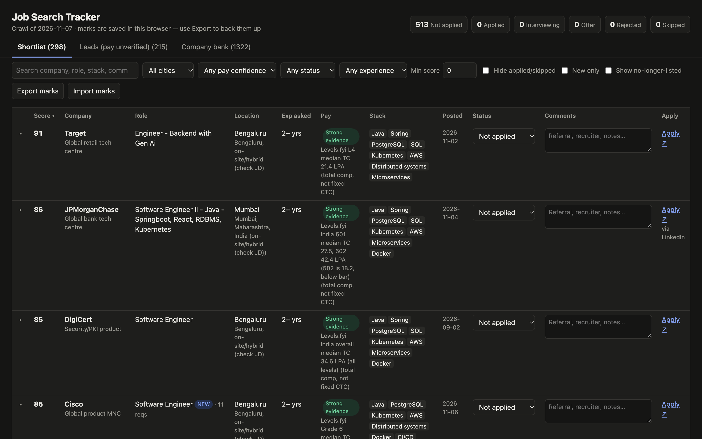
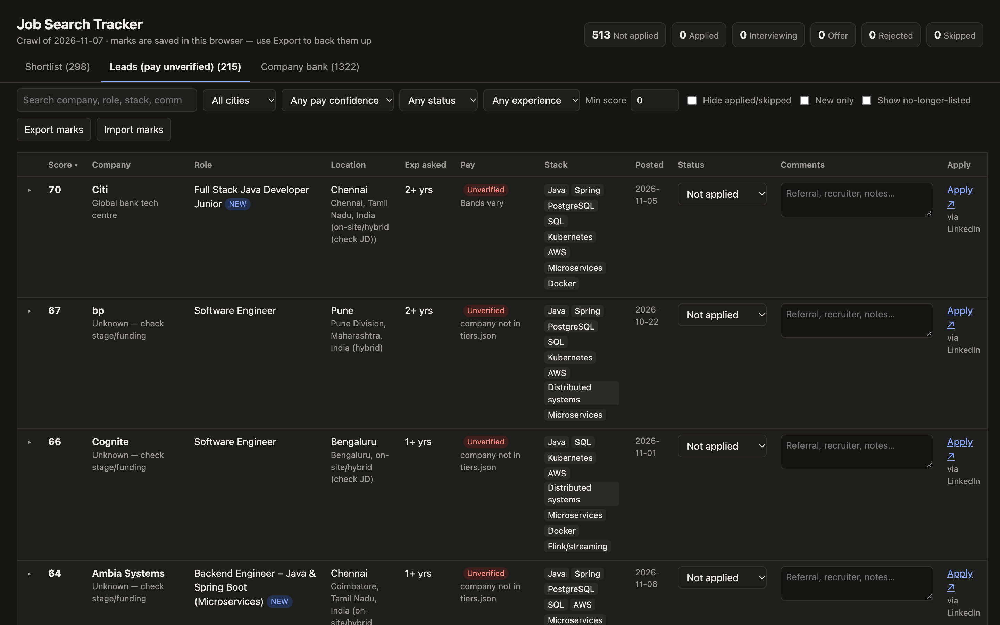
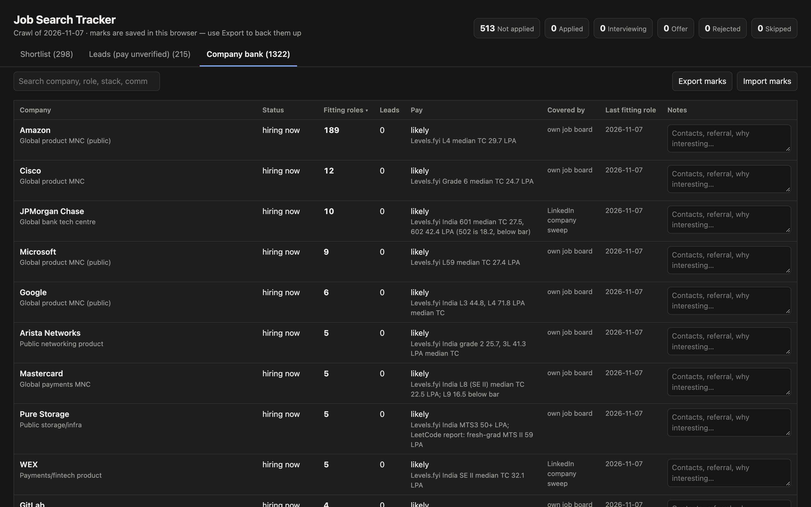

# India SWE Job Search

A local, read-only job-search pipeline for **software engineers in India**. It crawls company job boards and LinkedIn's public job search, filters roles against *your* requirements (level, years asked, city, pay floor, stack), scores them, and puts everything into a single offline **dashboard** where you can mark each role (Applied, Interviewing…) and keep notes.

**Live dashboard: https://24yash.github.io/india-swe-job-search/** (GitHub Pages serves whatever is on `main`, so it shows the latest committed crawl). Your Applied/comment marks are saved in your own browser.

The repo ships with a real data snapshot (see `output/`): about 200 ranked roles, 100+ leads and a bank of about 600 companies with pay evidence. Open `dashboard.html` to browse it right away, or personalise it and re-crawl.



<details><summary>More screenshots: leads and company bank</summary>




</details>

Tip: link straight to a tab with `dashboard.html#lead` or `dashboard.html#companies`.

> Scores and "gaps" in the snapshot were computed with the example profile in `profile.json` (backend/platform, 0–3 years, ₹20 LPA+, Java-leaning). Re-run with your own profile to re-rank.

---

## Quick start (human)

```bash
git clone https://github.com/24yash/india-swe-job-search && cd india-swe-job-search
python3 -m pip install requests        # the only dependency (Python 3.10+)
open dashboard.html                    # browse the shipped snapshot (macOS; xdg-open on Linux)
```

To use your own requirements:

1. Edit **`profile.json`**, at minimum:
   - `max_min_years`: the highest "N+ years" ask you'll accept;
   - `min_pay_lpa`: your pay floor;
   - `title.include` / `title.exclude`: which titles count;
   - `stack`: keywords and weights for your skills;
   - `gaps`: skills you lack, flagged per role;
   - `exclude_companies`: **add your current employer**;
   - `linkedin.queries` / `locations`.
2. Run the refresh:
   ```bash
   ./refresh.sh
   ```
   - About 1 minute: every company job board is crawled, and the shortlist and dashboard are rebuilt.
   - Then LinkedIn runs in the background (light mode, ~5–15 min) and rebuilds the dashboard every ~40 postings. Progress: `tail -f output/linkedin.log`.
   - For an occasional exhaustive pass (hours), run `python3 crawl.py --sources linkedin --deep`.
3. Open or reload `dashboard.html`; reload again later to see the LinkedIn results. Your marks carry over (see *Dashboard* below).

## Quick start (AI agent)

If you're an agent (Claude Code, Codex, Cursor…), follow **`.claude/skills/job-search/SKILL.md`**. Claude Code picks it up as the `/job-search` skill. In short:
1. Ask the user for their requirements and write them into `profile.json`.
2. Run `./refresh.sh` (fast sources in ~1 min; LinkedIn continues in the background).
3. Optionally check pay for new companies (below).
4. **Open `dashboard.html` for the user at the end.**

---

## How it works

```
profile.json  companies.json  tiers.json          ← your criteria, boards crawled directly, company bank
        │            │             │
        ▼            ▼             ▼
   crawl.py  ── fetch → normalise → resolve company → filter → score → dedupe
        │      --sources fast      company job boards, 10 in parallel (~1 min)
        │      --sources linkedin  LinkedIn, throttled; re-scores + rebuilds every ~40 postings
        │      --deep              LinkedIn per-city searches + big company sweep (hours; occasional)
        │      --rescore           re-score saved data only (~2 s), e.g. after editing tiers.json
        │
        ├─ output/jobs-<date>.csv              roles passing every filter, ranked
        ├─ output/leads-unverified-pay-<date>.csv   pass everything except pay evidence
        ├─ output/rejected-<date>.csv          dropped roles + reason (to audit the filters)
        ├─ output/company-bank-<date>.csv      every tracked company: hiring now / quiet / below bar
        └─ output/raw/<source>.json            latest raw data per source (git-ignored); a failed or slow
                                               source keeps its previous data instead of emptying the results
   report.py           → output/shortlist-table-<date>.md
   build_dashboard.py  → dashboard.html (static, data embedded; keeps output/job-archive.json)
```

### Sources
| Source | Covers |
|---|---|
| Greenhouse, Lever, Ashby, SmartRecruiters public APIs | Stripe, Databricks, Rubrik, MongoDB, Razorpay, Groww, CRED, Meesho, Snowflake, Sarvam, Freshworks, Swiggy… |
| Workday search API | Cisco, Salesforce, Adobe, eBay, Mastercard, Target, PayPal… |
| Amazon, Microsoft, Atlassian, Google careers | their own endpoints |
| LinkedIn public guest search (no login) | **light (default):** role keywords across India + a 40-company sweep (companies active last run and top-tier employers with no readable board: JPMorgan, Goldman, Uber, Flipkart, Walmart…). **`--deep`:** adds 7-city searches and a 180-company rotating sweep |

Add a company: `python3 discover_ats.py <slug> …` finds its board (Workday: `--workday <tenant>`). **`python3 discover_ats.py --bank`** does this for every company in the bank that has no direct board. It tries likely board names on Greenhouse, Lever, Ashby and SmartRecruiters (and reports Workable and Recruitee boards, which `crawl.py` can't read yet), checks the board's company name, and writes `output/discovered-boards.json` for review. One run turned 42 LinkedIn-only companies into direct sources. **`--careers`** reads boards straight from the careers URLs in the bank and from VC portfolio job boards' apply links, and names companies on platforms the crawler can't read yet (Darwinbox, Keka, Zoho Recruit). **`python3 import_lists.py`** grows the bank from public lists ([moreThanFAANGM](https://github.com/Kaustubh-Natuskar/moreThanFAANGM), [ISJB](https://github.com/pHequals7/isjb) VC portfolios). Put hits in `companies.json`; otherwise add it to `tiers.json` and the LinkedIn sweep will cover it.

### Filters (in order; each rejection records its reason)
1. India location.
2. Title include/exclude regexes, with word boundaries so team names like "Research Platform" aren't dropped.
3. Contract, contract-to-hire or intern wording.
4. Company pay below the bar, including per-level floors (`below_title`).
5. Experience asked: the smallest "N+ years" or "N–M years" in the job description; years in the title override it.
6. A posted INR pay range below the floor.
7. Pay confidence: **Posted** (stated in the JD) › **Strong** (levels.fyi evidence in `tiers.json`) › **Likely** (tier judgement) › **Unverified** (goes to leads, not the shortlist).

### Score (0–100)
| Part | Points | How |
|---|---|---|
| Stack match | 35 | weighted keywords; capped at 20 if the JD centres on a language you don't list |
| Level fit | 20 | years asked vs `max_min_years`; title signals when years aren't stated |
| Pay confidence | 20 | Posted 20, Strong 16, Likely 10, Unverified 0 |
| Company quality | 15 | from the bank, 0–15 |
| Freshness and link | 10 | newer is better; the company's own careers link beats LinkedIn |

### The company bank
`tiers.json` (~600) and `companies.json` (~90) form the bank. Companies are **never dropped for not hiring right now**. Each run writes `company-bank-<date>.csv` and appends to `bank-history.json`, so a quiet company that starts hiring shows up as "hiring now (new since last run)".

**Pay evidence** comes from levels.fyi India pages: `https://www.levels.fyi/companies/<slug>/salaries/software-engineer/locations/india.md`. levels.fyi blocks scripts, so look these up yourself or have an agent do it with a web-fetch tool. Record the result in `tiers.json` (`pay: likely|below`, `pay_note: "Levels.fyi India SE1 median TC 22.1 LPA"`) and run `python3 crawl.py --rescore`, which re-filters the cached crawl in seconds. These are **total comp** figures (base + stock + bonus), not fixed CTC.

## Dashboard
`dashboard.html` is one static file; just open it in Chrome, Safari or Firefox.

- **Tabs:**
  - Shortlist;
  - Leads (pay unverified);
  - Company bank.
- **Filters:**
  - search (it also searches your comments), city, pay confidence, status, **experience asked** (≤1 / ≤2 / ≤3 yrs / not stated), minimum score;
  - hide applied/skipped, new only, show no-longer-listed.
- **Per role:** a status (Not applied → Applied → Interviewing → Offer / Rejected / Skipped), a comment box, an expandable details row, and an apply link. Companies get a notes box.
- **Your marks live in the browser's localStorage, keyed by job link.** Rebuilding the page after a new crawl keeps them:
  - **Closed roles you marked** stay visible, tagged "no longer listed".
  - **Reposts** (same company, title and exact location under a new link) inherit your mark, labelled "carried over".
  - **Back up** with *Export marks* / *Import marks* (JSON). Clearing browser data or switching browsers otherwise loses them.

## Limits and etiquette
- **Read-only.** Public endpoints only; no logins, no applications, no personal data sent anywhere.
- **LinkedIn limits unsigned clients** (HTTP 429), which is why it runs separately and slowly:
  - All LinkedIn calls share one throttle (`seconds_between_requests`).
  - The run stops LinkedIn after four 429s in a row.
  - Light mode is the default because it's where nearly all LinkedIn value comes from. In a measured run, LinkedIn supplied 6 of the top 10 roles and 22 companies with no readable board, almost all of it from the India-wide role searches; the deep extras added a handful of roles for hours of crawling.
  - The company sweep searches a slice of the bank each run; postings from companies not searched this time are kept while they're inside the freshness window.
  - Job descriptions are cached (`output/linkedin-details.json`), so later runs are faster.

  Don't lower the throttle or run LinkedIn crawls back to back.
- **Not covered:**
  - Naukri (reCAPTCHA);
  - Instahyre, Hirist and Cutshort (login required);
  - Myntra's portal (bot protection);
  - Walmart's Workday API (refused; Walmart is covered through LinkedIn).
- **Expiry:** company-board roles count as open while the board lists them, at any age. LinkedIn roles not seen again are checked on LinkedIn: closed ones are dropped, open ones kept at any age, and unchecked ones are kept only while younger than `max_age_days`.
- **Snapshot age:** the shipped data is from the crawl date shown in the dashboard header. Job data belongs to the respective employers; check every role on the employer's site before applying.

## Files
| File | Purpose |
|---|---|
| `profile.json` | Your requirements and scoring weights |
| `companies.json` | Boards crawled directly (+ the two LinkedIn sources) |
| `tiers.json` | Company bank: type, quality, pay status and evidence; services/staffing exclusion list |
| `crawl.py` | The pipeline (`--sources fast\|linkedin\|all`, `--rescore`, `--only "A,B"`, `--max-age 30`) |
| `discover_ats.py` | Find a company's Greenhouse/Lever/Ashby/SmartRecruiters/Workday board |
| `report.py` | Markdown shortlist table (max 3 per company) |
| `build_dashboard.py`, `dashboard_template.html` | Build the dashboard |
| `refresh.sh` | Fast crawl + dashboard now, then LinkedIn in the background |
| `import_lists.py` | Grow the company bank from public company lists |
| `DESIGN.md` | Design decisions, what was rejected and why, improvement backlog |
| `tests/` | Fixture tests (`python3 tests/<file>.py .`); they never touch real data |
| `.claude/skills/job-search/SKILL.md` | Agent instructions |
